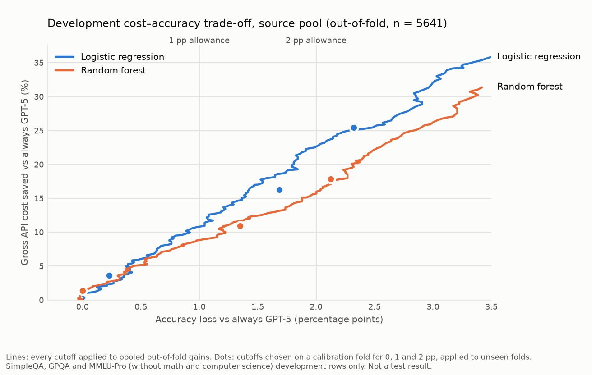

# Development results and algorithm selection

Date: 2026-11-16. This is the selection rerun on the source pool: the train+validation
rows of SimpleQA, GPQA, and MMLU-Pro without its math and computer-science questions
(5,641 questions). The locked test split, HLE, LiveCodeBench, AIME, LiveMathBench,
ARC-AGI and SWE-bench have not been read by any model. These are development estimates,
not final results.

Source files: `results/dev_selection/selection.json`, per-candidate
`oof_predictions.csv` and `summary.json`, `diagnostics.json`, `dev_tradeoff.png`.
Procedure: `docs/PROTOCOL.md` section 6. The first run, on the unfiltered pool, is kept
in `docs/archive/DEV_RESULTS_v1_unfiltered.md`.

## Outcome

**Selected for the main study under the pre-specified rule: random forest** (300 trees,
minimum leaf size 20, 10% of features per split, TF-IDF plus the ten prompt statistics).

Logistic regression saved more, but its out-of-fold accuracy loss at the 1 pp allowance
was 1.68 pp, above the 1.5 pp qualification limit, so the rule excludes it. ModernBERT
was not refitted on this pool; the team deferred it to a GPU run.

This is a close call that the team should confirm before the final evaluation; see
"How to read the comparison" below.

## Baselines on the same questions

| Policy | Accuracy | Recorded cost | Savings vs GPT-5 | Accuracy loss |
|---|---:|---:|---:|---:|
| Always GPT-5 | 62.40% | $77.59 | 0% | 0 pp |
| Always Flash | 48.45% | $10.22 | 86.8% | 13.95 pp |

## Candidate comparison (out-of-fold, cutoff chosen on a separate fold)

| Candidate | Allowance | Gross savings (95% CI) | Actual loss, pp (95% CI) | Sent to Flash |
|---|---|---:|---:|---:|
| Logistic regression | 0 pp | 3.6% (2.8 to 4.5) | 0.23 (0.00 to 0.46) | 5.4% |
| | **1 pp** | **16.2% (14.7 to 17.8)** | **1.68 (1.21 to 2.17)** | 26.7% |
| | 2 pp | 25.5% (23.7 to 27.2) | 2.32 (1.73 to 2.91) | 36.9% |
| Random forest | 0 pp | 1.4% (1.0 to 1.9) | 0.00 (−0.14 to 0.12) | 2.5% |
| | **1 pp** | **10.9% (9.7 to 12.2)** | **1.35 (0.92 to 1.76)** | 18.7% |
| | 2 pp | 17.9% (16.4 to 19.3) | 2.13 (1.58 to 2.67) | 28.9% |

Intervals are paired bootstraps over questions with decisions fixed. They do not include
variability from refitting or from choosing cutoffs.

Selection rule at 1 pp:
1. Qualification (loss ≤ 1.5 pp): random forest qualifies (1.35); logistic regression
   does not (1.68).
2. Highest savings among qualified routers: random forest.
3. Parsimony guard: not triggered, since only one router qualifies.

## How to read the comparison

1. **The disqualification is within noise.** The difference in actual loss between the
   two routers (logistic minus forest) has a 95% interval of −0.09 to 0.78 pp, which
   includes zero. Logistic regression's own interval (1.21 to 2.17) straddles the 1.5 pp
   limit. On the first run, with 370 more MMLU-Pro questions in the pool, the same
   router sat at 1.43 pp and qualified.

2. **At the same actual loss, logistic regression still saves more.** Choosing cutoffs
   on the pooled out-of-fold gains (a diagnostic computed after the fact, optimistic for
   both alike):

   | Actual loss | Logistic | Forest |
   |---|---:|---:|
   | 0.5 pp | 6.1% | 5.2% |
   | 1.0 pp | 10.8% | 8.9% |
   | 1.5 pp | 17.1% | 12.4% |
   | 2.0 pp | 22.5% | 15.7% |

   So the rule picks the router that kept closer to the allowance, not the one with the
   better trade-off curve. Following the rule is the pre-specified choice. Choosing
   logistic regression instead would be a change made after seeing these results and
   would have to be reported as such.

3. **The allowance is not held out of sample.** Both routers exceed 1 pp on unseen
   folds, and per-fold results vary widely: logistic regression 8.5% to 25.4% savings
   and 0.98 to 2.46 pp loss; forest 8.2% to 15.8% and 0.98 to 1.85 pp. A cutoff tuned on
   about 1,100 questions to sit exactly at the constraint is optimistic.

4. **Savings come mainly from MMLU-Pro.** At 1 pp:

   | Candidate | MMLU-Pro (savings / loss / to Flash) | SimpleQA | GPQA |
   |---|---|---|---|
   | Logistic | 34.4% / 3.61 pp / 64% | 7.3% / 0.55 pp / 6% | 9.6% / 1.90 pp / 8% |
   | Forest | 23.3% / 2.82 pp / 44% | 5.8% / 0.55 pp / 5% | 0.0% / 0.00 pp / 0% |

   A pooled allowance does not protect any single benchmark: MMLU-Pro alone loses about
   3 points.

5. **The question-level signal is weak.** Predicted gain correlates 0.12–0.14 with Y and
   explains 1–2% of its variance. A router that knew Y would save 70.5% with a 5.8-point
   accuracy gain on these questions (a ceiling for context, not a planned baseline).

## Search and compute record

| Candidate | Chosen configuration | Fits | Total fit time | Prediction time | Device |
|---|---|---:|---:|---:|---|
| Logistic | C = 0.3, with statistics | 50 | 55 s | 0.09 ms/question | CPU (M2 Pro) |
| Forest | 300 trees, leaf 20, max_features 0.1, with statistics | 25 | 71 s | 0.14 ms/question | CPU, 8 threads |
| ModernBERT | not run on this pool | | | | deferred to a GPU |

The configuration chosen inside each rotation varied (logistic C from 0.1 to 1.0); the
frozen configuration is the one with the lowest mean calibration error.

## Gross versus net savings

All savings above are gross: recorded API cost only. Both CPU routers predict in about
0.1 ms per question. At an assumed $0.10 per CPU-hour that is under $0.00000001 per
question, against an average GPT-5 call of $0.0138 in this pool, so net and gross
savings agree to two decimal places. An always-on server, idle capacity, added latency
and engineering time were not measured.

## ModernBERT

- First run (unfiltered pool, 6,011 questions, 512-token prompts on this Mac's MPS
  backend): 9.7% savings at 0.78 pp loss, against 16.2% at 1.43 pp for logistic
  regression and 11.5% at 1.26 pp for the forest. At the same actual loss it was close
  to logistic regression. Details are in the archived write-up.
- Refit on the source pool: not done. It is deferred to a GPU, where it will use
  1,024-token prompts and batches of 16 (`python scripts/05_dev_compare.py modernbert`,
  then `scripts/06_select_algorithm.py`). If the final evaluation has been run by then,
  the result is reported as a development comparison and does not change the
  main-study algorithm.

## Not done

- No model has been evaluated on the locked test split or any held-out benchmark.
  `scripts/07_final_eval.py --unlock-final` runs that once; it was rehearsed with
  `--dry-run` on development rows only, and `scripts/09_report_final.py` turns its output
  into tables and figures.
- No GPU run.
