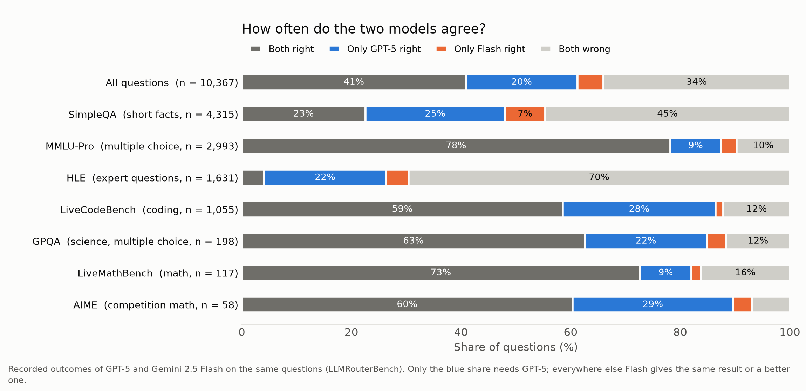
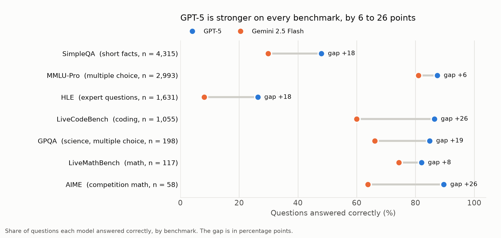
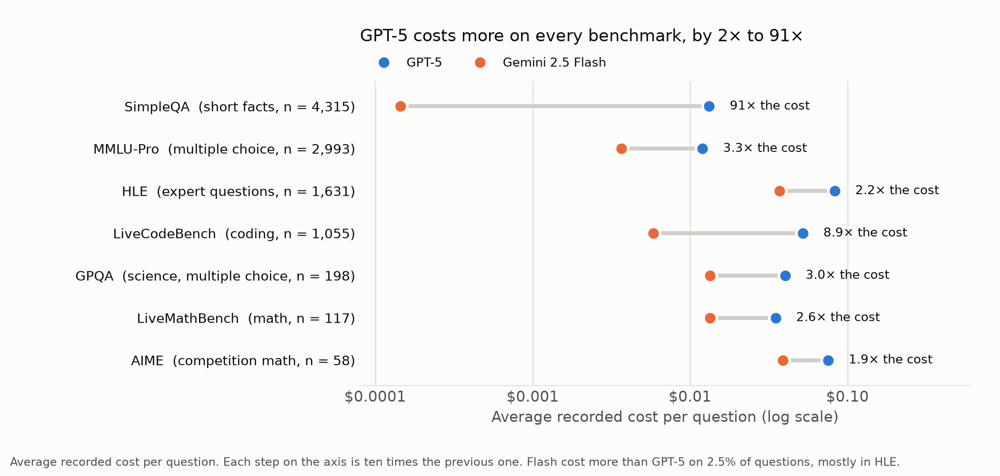
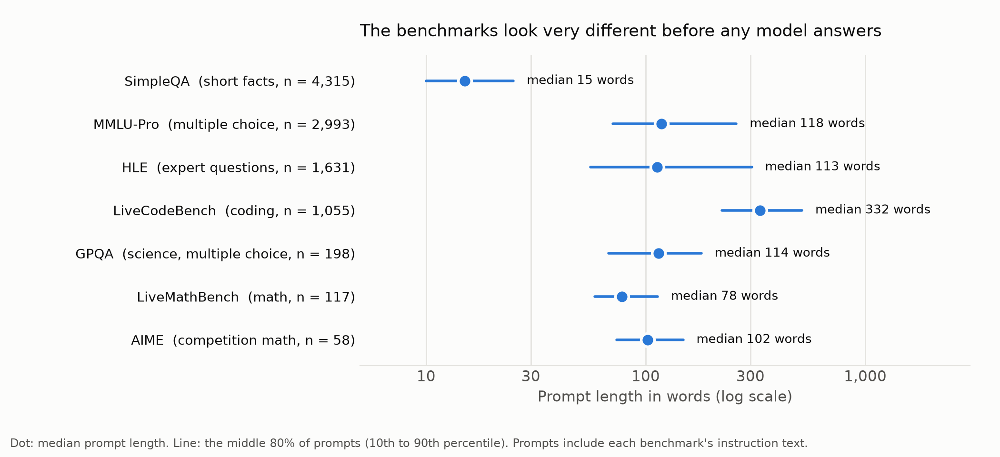
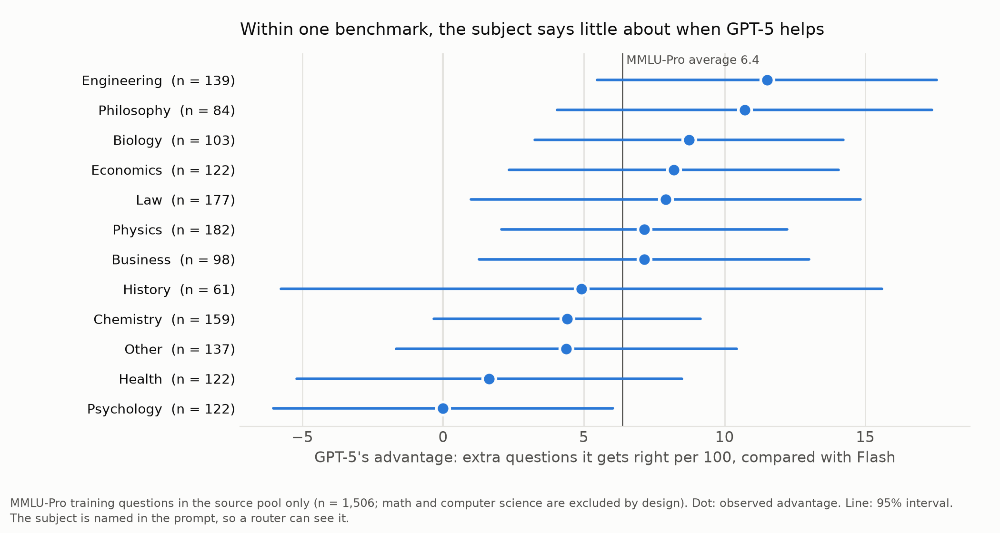
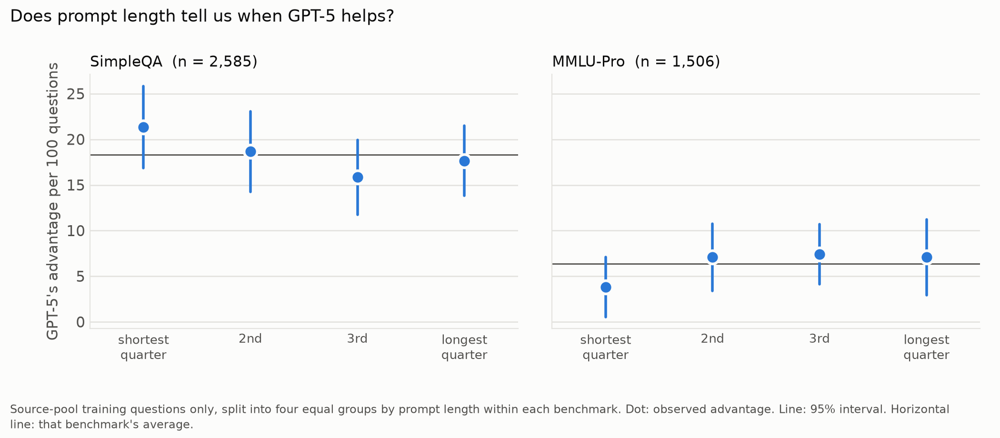

# Exploratory data analysis

Produced by `scripts/10_eda.py`; numbers are in `results/eda/eda_summary.json`.

This describes the recorded outcomes of the two LLMs before any router is involved. Each
figure checks one expectation the study rests on.

- Figures 1–4 use all 10,367 eligible corpus questions. They are baseline facts about the
  two models, the same ones the data audit reports.
- Figures 5–6 relate features of the question to the outcome, so they use source-pool
  training questions only (4,210). No router from the revised protocol has been evaluated
  on the locked splits.

## 1. Is there room to route at all?

Expectation: on many questions the choice of model does not change the outcome.

- Confirmed. Both models are right on 41% of questions and both wrong on 34%, so the
  result is the same on 75%.
- GPT-5 is the only one right on 20%; Flash is the only one right on 5%.
- The picture differs sharply by benchmark. On MMLU-Pro the models agree on 88% of
  questions. On HLE they agree on 74%, but almost always because both are wrong.
- "Both wrong" matters for routing: those questions are hard, yet sending them to Flash
  loses nothing.

## 2. Is GPT-5 the stronger model?

Expectation: GPT-5 answers more questions correctly than Flash.

- Confirmed on all seven benchmarks.
- The margin ranges from 6 points (MMLU-Pro) to 26 points (LiveCodeBench, AIME).
- Consequence: a question sent to Flash by mistake is far more likely to cost a correct
  answer on coding than on MMLU-Pro. A cutoff that is safe on one mix need not be safe on
  another.

## 3. Is GPT-5 the costlier model?

Expectation: GPT-5 costs more per question.

- Confirmed on average for every benchmark, and 3.5 times overall.
- The gap is far from uniform: 91 times on SimpleQA, about 2 times on HLE and AIME.
- Not true question by question: Flash cost more than GPT-5 on 2.5% of questions, mostly
  in HLE, where it writes much longer answers.
- Consequence: the money saved by routing a question depends heavily on what kind of
  question it is.

## 4. Do the benchmarks look different from the prompt alone?

Expectation: a router that sees only the prompt can tell the kinds of question apart.

- Confirmed. A SimpleQA prompt is a single sentence (median 15 words); a LiveCodeBench
  prompt has a median of 332 words; the others sit around 80 to 120.
- Each benchmark also has its own instruction wording.
- Consequence: a router can learn "what kind of question is this" without being told the
  benchmark. That is realistic, but it means part of any saving may come from recognising
  the kind of question, not from judging the individual one. The within-benchmark shuffle
  diagnostic was added to separate the two.

## 5. Within one benchmark, does the subject matter?

Expectation: a visible feature of the prompt, here the subject named in MMLU-Pro's
instruction, is associated with when GPT-5 helps.

- Weakly. GPT-5's advantage ranges from 0 extra correct answers per 100 in psychology to
  about 11 per 100 in engineering and philosophy.
- The intervals are wide (about ±6) and most of them include the benchmark average of
  6.4, so only the extremes are distinguishable.

## 6. Does prompt length matter?

Expectation: longer or shorter prompts differ in how much GPT-5 helps.

- Barely. In SimpleQA the advantage is 21 per 100 for the shortest quarter and 16 to 19
  for the rest. In MMLU-Pro it is 4 per 100 for the shortest quarter and 7 for the rest.
- The intervals overlap almost entirely.

## What the EDA says about the modelling

1. The opportunity is real: three quarters of questions give the same result either way.
2. Most of the visible structure is between kinds of question (accuracy gap, cost gap,
   prompt shape), not within a kind.
3. Simple features of an individual question carry only a weak signal about when GPT-5
   helps. This matches the later finding that the fitted routers explain 1–2% of the
   variation in the outcome.
4. Accuracy gap and cost gap both vary by benchmark, so results depend on the mix of
   questions and should be reported per benchmark as well as pooled.
