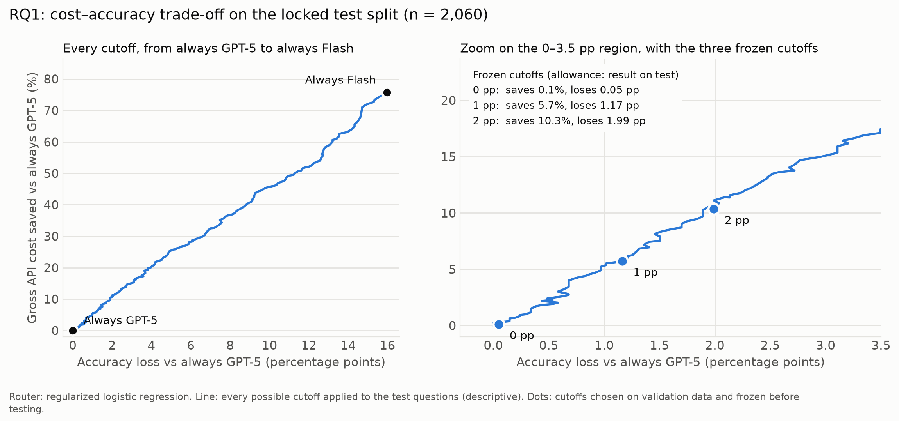
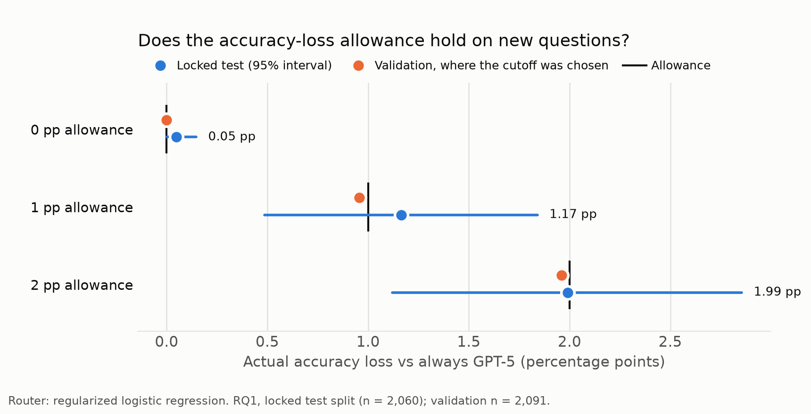
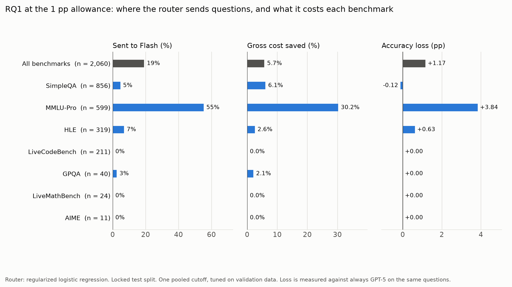

# RQ1 results

RQ1: how much can a router save compared with always using GPT-5, and what does that do
to accuracy?

Each model is scored once on the locked test split (2,060 questions from all seven
benchmarks), after its settings were fixed in its development run and its cutoffs were
tuned on the validation split and frozen. Full tables and figures per model are in
`results/final/<model>/report/`.

| Model | Owner | RQ1 test |
|---|---|---|
| Regularized logistic regression | Rahul | run on 2026-11-16, below |
| Gradient boosting | to be assigned | pending |
| Fine-tuned text encoder | to be assigned | pending |

The final model is named from the development results of all three
(`docs/DEV_RESULTS.md`), not from the numbers on this page.

## Logistic regression

Trained on 6,216 questions, cutoffs tuned on 2,091 validation questions. Settings from the
development run: C = 0.3 with the simple prompt statistics.

### Headline

| Policy | Accuracy | Recorded cost | Bill saved (95% CI) | Accuracy lost, pp (95% CI) | Sent to Flash |
|---|---:|---:|---:|---:|---:|
| Always GPT-5 | 61.84% | $61.30 | 0% | 0 | 0% |
| Router, tuned for 0 pp | 61.80% | $61.23 | 0.1% (0.0 to 0.2) | 0.05 (0.00 to 0.15) | 0.4% |
| **Router, tuned for 1 pp** | **60.68%** | **$57.79** | **5.7% (4.7 to 6.9)** | **1.17 (0.49 to 1.84)** | **19.1%** |
| Router, tuned for 2 pp | 59.85% | $54.96 | 10.3% (8.8 to 12.1) | 1.99 (1.12 to 2.85) | 30.3% |
| Router, tuned for 3 pp (added later) | 58.64% | $51.42 | 16.1% (13.9 to 18.5) | 3.20 (2.15 to 4.26) | 40.5% |
| Router, tuned for 5 pp (added later) | 56.75% | $45.46 | 25.8% (22.8 to 29.2) | 5.10 (3.77 to 6.45) | 53.8% |
| Always Flash | 45.87% | $14.85 | 75.8% | 15.97 | 100% |

The 0, 1 and 2 point limits were fixed before any test. The 3 and 5 point limits were added
after the first test result was known, to show how the trade-off continues for a company
willing to give up more accuracy (protocol log entry 12). They were tuned on validation and
scored exactly like the others, and adding them left the 0, 1 and 2 results unchanged.

### Did the accuracy target hold?

| Tuned for | Loss on validation | Loss on test |
|---|---:|---:|
| 0 pp | 0.00 | 0.05 |
| 1 pp | 0.96 | 1.17 |
| 2 pp | 1.96 | 1.99 |
| 3 pp (added later) | 2.97 | 3.20 |
| 5 pp (added later) | 4.97 | 5.10 |

The targets were close but not guaranteed. At the 1-point target the test loss was 1.17,
and its interval (0.49 to 1.84) includes values well above 1. In the bootstrap, the loss
stayed within 1 point in about a third of resamples. At the 2-point target the test loss
landed almost exactly on the target.

### Where the saving comes from (1 pp target)

| Benchmark | Questions | GPT-5 right | Flash right | Sent to Flash | Bill saved | Accuracy lost, pp |
|---|---:|---:|---:|---:|---:|---:|
| SimpleQA | 856 | 50.0% | 31.1% | 4.7% | 6.1% | −0.12 |
| MMLU-Pro | 599 | 87.6% | 81.3% | 55.3% | 30.2% | 3.84 |
| HLE | 319 | 23.8% | 6.3% | 6.9% | 2.6% | 0.63 |
| LiveCodeBench | 211 | 85.8% | 58.3% | 0.0% | 0.0% | 0.00 |
| GPQA | 40 | 87.5% | 65.0% | 2.5% | 2.1% | 0.00 |
| LiveMathBench | 24 | 83.3% | 66.7% | 0.0% | 0.0% | 0.00 |
| AIME | 11 | 81.8% | 63.6% | 0.0% | 0.0% | 0.00 |
| Equal-benchmark average | | | | | 5.9% | 0.62 |

The router sends more than half of MMLU-Pro to Flash and almost nothing from coding or
math. Nearly all of the pooled accuracy loss falls on MMLU-Pro, which loses 3.8 points.

### How much does each point of accuracy buy?

| Policy | Bill saved per point of accuracy lost |
|---|---:|
| Router, tuned for 1 pp | 4.9% |
| Router, tuned for 2 pp | 5.2% |
| Router, tuned for 3 pp | 5.0% |
| Router, tuned for 5 pp | 5.1% |
| Always Flash | 4.7% |

At the five tuned limits (0 to 5 points) the router buys slightly more saving per point of
accuracy than always using Flash does, about 5% of the bill per point against 4.7%. Read
off the full test curve, it sits up to about 2 points of savings above the straight line
between the two baselines at small losses, crosses it near 6 points of loss, and falls
below it at large losses (about 1.7 points under at 10 points of loss, about 5 under at
12). So the router is only useful for small accuracy losses; past roughly 6 points, simply
mixing GPT-5 and Flash in fixed proportions would save more. Its value on this test is that
it lets you choose a small accuracy loss, not that it makes each point of accuracy much
cheaper to give up.

### Is the router more than benchmark recognition?

Shuffling the router's choices inside each benchmark, keeping the number sent to Flash
(2,000 shuffles):

| Tuned for | Router: saved / lost | Shuffled: saved / lost (95% range of loss) | Router's accuracy advantage | Shuffles at least as accurate |
|---|---|---|---:|---:|
| 1 pp | 5.7% / 1.17 pp | 7.5% / 1.58 pp (1.07 to 2.14) | +0.42 pp | 7.6% |
| 2 pp | 10.3% / 1.99 pp | 13.2% / 2.80 pp (2.18 to 3.45) | +0.81 pp | 0.5% |
| 3 pp | 16.1% / 3.20 pp | 20.3% / 4.22 pp (3.50 to 4.95) | +1.01 pp | 0.4% |
| 5 pp | 25.8% / 5.10 pp | 30.2% / 6.53 pp (5.68 to 7.38) | +1.43 pp | 0.1% |

The router is more accurate than policies with the same per-benchmark routing rates, and
the advantage grows as more questions are sent to Flash: only suggestive at 1 point,
clear from 2 points on. It also saves
less than they do, because the questions it chooses to send to Flash are cheaper ones.

### If the workload had more coding

Same frozen decisions, questions reweighted so that LiveCodeBench makes up a larger share
(it is 10.2% of the test split):

| Coding share | Saved / lost at 1 pp target | Saved / lost at 5 pp target |
|---|---:|---:|
| 10% | 5.7% / 1.17 | 26.0% / 5.11 |
| 25% | 4.2% / 0.97 | 19.2% / 4.34 |
| 50% | 2.3% / 0.65 | 10.9% / 3.05 |

The router keeps coding questions on GPT-5, so the more coding there is, the less it saves.

### Sensitivity checks

| Check | Bill saved (1 pp target) | Accuracy lost, pp |
|---|---:|---:|
| Main result | 5.7% | 1.17 |
| HLE with repaired costs (2,167 questions) | 5.0% | 1.11 |
| Costs at list prices | 5.7% | 1.17 |

### Router overhead

Fitting took 3.6 seconds and prediction about 0.19 ms per question on a laptop CPU. That is
negligible next to an average GPT-5 call of about $0.03, so gross and net savings are
effectively the same. Serving costs (an always-on machine, added delay) were not measured.

### Summary for logistic regression

- Tuned for a 1-point loss, the router cut the bill by 5.7% and lost 1.17 points.
- Tuned for 2 points, it cut the bill by 10.3% and lost 1.99 points.
- With looser limits added afterwards: 16.1% saved for 3.20 points, 25.8% for 5.10 points.
- The saving comes almost entirely from sending MMLU-Pro questions to Flash.
- Per point of accuracy given up, it saves slightly more than always using Flash up to about
  6 points of loss; beyond that, less.
- Development and test agree: the development run predicted 6.4% at 1.08 points.

### What this result does not cover

- One model only. The other two models' results, and the choice of final model, are pending.
- These benchmarks in this mix. The workload table shows the saving depends on the mix.
- Intervals reflect which test questions were drawn, not refitting or re-tuning.
- The test questions were held out from all model fitting, tuning and selection. The
  earlier pilot and the data audit did touch them in aggregate.
