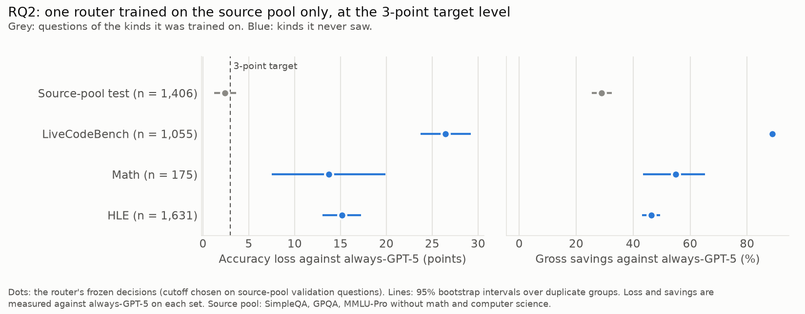
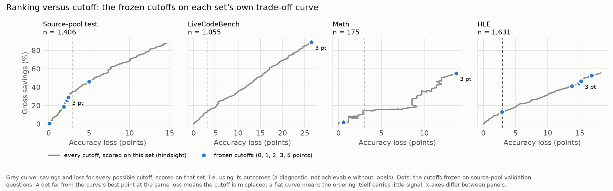
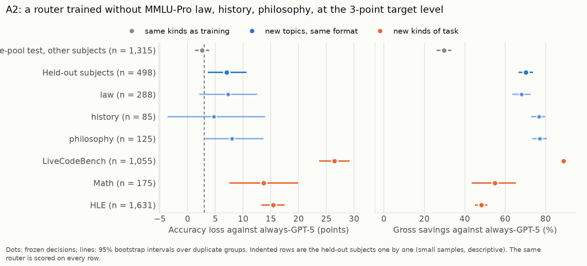

# RQ2 results: transfer to unseen kinds of questions

RQ2: does the cost and accuracy trade-off still hold on kinds of questions the router never
saw in training?

The design (workstreams A and A2) is in `docs/PROTOCOL.md` section 8. It was written and
committed before the run (log entry 23). The run was made once, on 2026-11-26, from commit
`0f26701` with no uncommitted changes. It made five sealed reads and there were none before
(log entry 24). RQ2 evaluates logistic regression only, with C = 0.3 and the simple prompt
statistics, settings chosen in the source-pool development run. The full tables are in
`results/rq2/logistic/report/tables.md`.

## In brief

- **No.** A router trained only on knowledge questions (SimpleQA, GPQA, MMLU-Pro without
  math and computer science) keeps its trade-off on new questions of those kinds. It does
  not keep it on coding, math or HLE.
- **Primary result (declared in advance): LiveCodeBench at the 3-point target.**
  - The frozen router sent all 1,055 coding questions to Flash. It lost 26.45 points of
    accuracy (95% interval 23.72 to 29.22) against a 3-point target, and its 88.8% saving
    is simply always-Flash. Reading: *clearly exceeded*.
  - On the source pool's own test questions, the same router saved 28.9% (25.5 to 32.4) for
    2.42 points (1.21 to 3.64). Reading: *within the target, clear savings*.
- **The failure does not depend on the target level.** Coding goes entirely to Flash at
  every level from 0 to 5 points. Math goes to Flash from 1 point up (13.7 points lost), and
  HLE loses 13.7 to 16.8 points from 1 point up.
- **Two things go wrong at once.**
  - *Level:* the router believes GPT-5 has no edge on coding. Its average predicted gain is
    −0.03, while GPT-5's real edge on LiveCodeBench is 26 points, the largest of any set. So
    every coding question falls below even the 0-point cutoff.
  - *Order:* within each new set, the predicted gains do not pick out the questions only
    GPT-5 gets right (AUC 0.49 coding, 0.53 math, 0.49 HLE, against 0.64 on the source test).
    So even a cutoff re-tuned in hindsight on the coding questions' own answers would save
    only 12.8% at the 3-point target.
- **A router that had seen the benchmark does not fail this way.** On the same 211 coding
  test questions, the RQ1 router (trained with LiveCodeBench) sent none to Flash and lost
  nothing. The transfer router lost 27.49 points more (21.33 to 33.65).
- **New topics (A2) hurt far less than new kinds of task, and part of it is not about the
  topics being new.**
  - A router trained without MMLU-Pro law, history and philosophy lost 7.03 points (3.61 to
    10.59) on those subjects at the 3-point target, against 26.45 on coding.
  - A router that was trained with those subjects did no better on their 91 test questions
    (3.30 points lost by each).
- **Why coding goes to Flash** (a post-hoc check that reads prompts only):
  - In training, long prompts were mostly MMLU-Pro, where GPT-5's edge is small (6 points;
    median 127 words). SimpleQA's one-sentence questions carry an 18-point edge.
  - The router learned "longer prompt, smaller edge". Coding prompts are longer and have more
    lines than almost anything it saw, and they contain code, which it almost never saw.
  - With the prompt statistics held at their training averages, the average predicted gain
    on coding would be 0.16 instead of −0.03.

## Workstream A: one router, trained on the source pool only

Trained on 4,210 source-pool questions; cutoffs chosen on 1,430 source-pool validation
questions, then frozen and scored on each set.

### Primary result

| Set | n | GPT-5 accuracy | Flash accuracy | Sent to Flash | Bill saved (95% CI) | Accuracy lost, pp (95% CI) | Chance of staying within 3 pp | Reading |
|---|---:|---:|---:|---:|---:|---:|---:|---|
| **LiveCodeBench (primary)** | 1,055 | 86.4% | 60.0% | 100% | 88.8% (87.3 to 90.2) | 26.45 (23.72 to 29.22) | 0.00 | clearly exceeded |
| Source-pool test (reference) | 1,406 | 64.3% | 49.7% | 39.9% | 28.9% (25.5 to 32.4) | 2.42 (1.21 to 3.64) | 0.83 | within the target, clear savings |

The protocol fixed the reading rule before the run. The trade-off "holds" on a set only if
the loss is within the target and the savings are clearly above zero. On LiveCodeBench the
savings are clear, but the loss is clearly over the target, so it does not hold. Always-Flash
would give the same numbers: 88.8% saved, 26.45 points lost.

### Every set and target level

| Set | 0 pp | 1 pp | 2 pp | 3 pp | 5 pp | Always Flash |
|---|---|---|---|---|---|---|
| Source-pool test (1,406) | 0.6% / 0.07 | 18.6% / 1.85 | 25.8% / 2.28 | 28.9% / 2.42 | 46.0% / 4.98 | 87.7% / 14.58 |
| LiveCodeBench (1,055) | 88.8% / 26.45 | 88.8% / 26.45 | 88.8% / 26.45 | 88.8% / 26.45 | 88.8% / 26.45 | 88.8% / 26.45 |
| Math (175) | 1.7% / 0.57 | 54.9% / 13.71 | 54.9% / 13.71 | 54.9% / 13.71 | 54.9% / 13.71 | 54.9% / 13.71 |
| HLE (1,631) | 13.0% / 2.88 | 41.3% / 13.73 | 44.4% / 14.90 | 46.3% / 15.14 | 52.7% / 16.80 | 55.5% / 18.27 |

Each cell is bill saved / accuracy lost in points. Intervals and readings for every cell
are in `tables.md`.

- **Source-pool test.** At 1 and 2 points the loss ran a little over the target (1.85 and
  2.28), as RQ1's test did at 1 point (1.17). At 3 and 5 points it held.
- **Math** (secondary; 175 questions, one question = 0.57 pp). From 1 point up the router
  is always-Flash. AIME lost 25.9 points and LiveMathBench 7.7.
- **HLE** (secondary). Both models do poorly here (GPT-5 26.4%, Flash 8.1%). Even at
  0 points the router sent 17.8% to Flash and lost 2.88 points (1.91 to 3.81). With repaired
  HLE costs (2,130 questions, the required check), the savings are up to 4 points higher and
  the losses within about half a point.
- **List prices for LiveCodeBench** (open item 1): 84.6% saved instead of 88.8%, with the
  same loss.

### The router that had seen the benchmark

These are the target benchmarks' test-split questions only. The RQ1 router was trained on
these benchmarks' train questions, and its frozen decisions come from its RQ1 test. The
difference is the transfer router minus the RQ1 router, from a paired bootstrap.

| Set (test split) | n | Transfer router at 3 pp: saved / lost | RQ1 router at 3 pp: saved / lost | Loss difference, pp (95% CI) |
|---|---:|---:|---:|---:|
| LiveCodeBench | 211 | 88.0% / 27.49 (100% to Flash) | 0.0% / 0.00 (none to Flash) | +27.49 (21.33 to 33.65) |
| HLE | 319 | 54.2% / 15.36 | 9.8% / 3.76 | +11.60 (7.19 to 16.26) |
| Math | 35 | 50.4% / 17.14 | −7.1% / 8.57 | +8.57 (−2.86 to 20.59) |

- Having seen coding questions in training is the whole difference on LiveCodeBench. The
  RQ1 router knew to keep coding on GPT-5; the transfer router did not.
- Math has only 35 test questions, so it is not read.

### Ranking versus cutoff (diagnostic)

The *hindsight* cutoff is the one the protocol's rule would pick using the set's own
outcomes. It is not achievable without those labels and is never the router's result. It
shows whether a miss comes from where the cutoff sits or from how the router orders the
questions.

| Set | Mean predicted gain | Real mean advantage | AUC, only-GPT-5-right questions | Frozen cutoff at 3 pp: sent / saved / lost | Hindsight cutoff at 3 pp: sent / saved / lost |
|---|---:|---:|---:|---:|---:|
| Source-pool test | 0.138 | 0.146 | 0.643 | 39.9% / 28.9% / 2.42 | 46.2% / 35.2% / 2.99 |
| LiveCodeBench | −0.034 | 0.264 | 0.493 | 100% / 88.8% / 26.45 | 10.4% / 12.8% / 2.94 |
| Math | 0.038 | 0.137 | 0.528 | 100% / 54.9% / 13.71 | 38.9% / 14.4% / 2.86 |
| HLE | 0.060 | 0.183 | 0.491 | 79.5% / 46.3% / 15.14 | 18.5% / 13.1% / 2.94 |

- **The level is wrong.** On coding the predicted gains lie between −0.047 and −0.014
  (5th to 95th percentile). All of that is below the 0-point cutoff of 0.011, so nothing
  stays on GPT-5. On math and HLE the predicted gains are also far below the real advantage.
- **The order is uninformative.** An AUC of about 0.5 means the router cannot tell, within
  coding, math or HLE, which questions need GPT-5. In the within-benchmark shuffle on HLE,
  96% of random choices at the same rate were at least as accurate as the router's at
  1 point. On the source test only 0.2% were, at 3 points.
- **Re-tuning the cutoff alone would not rescue it.** Even with hindsight, the best cutoff
  at 3 points saves 12.8% on coding, 14.4% on math and 13.1% on HLE, against 35.2% on the
  source test. Those hindsight figures are optimistic, because the cutoff is fitted to the
  same questions. This bounds the "re-tune only the cutoff" arm of workstream B.

### Why coding goes to Flash (post hoc, prompts only)

`rq2/posthoc_prompt_statistics.py` refits A's router exactly as the run did and checks that
it reproduces every recorded gain. It then recomputes each set's predicted gains with the
ten prompt statistics held at their training averages. It reads only prompt text for the
target sets. This check was written after the results were known; it explains a result and
chooses nothing.

| Set | Mean predicted gain | With the statistics at their training average |
|---|---:|---:|
| Source-pool test | 0.138 | 0.127 |
| LiveCodeBench | −0.034 | 0.163 |
| Math | 0.038 | 0.142 |
| HLE | 0.060 | 0.134 |

- **What the router learned in training.** On the source pool's train split, SimpleQA
  questions are a single sentence (median 15 words) and GPT-5's edge on them is 18.3
  points. MMLU-Pro questions are long (median 127 words, ten options) and its edge is 6.4
  points. So the router learned "longer prompt, smaller edge": the weights on character
  count and line count are negative.
- **How coding prompts differ.** On average they sit 1.9 training standard deviations
  above the training mean in character count and 2.5 in line count (both on a log scale).
  Their code indicator sits 9.5 standard deviations above it: about 1% of training prompts
  matched it. Together these push the predicted gain below zero.
- **Interpretation.** A linear model is extrapolating a pattern that held between two
  training benchmarks to a kind of question it never saw. It is not evidence that a router
  without the statistics would transfer. The order would still be uninformative, and that
  model was not chosen in advance, so it is not evaluated here.
- **For workstream C:** these statistics are label-free warning signs. The code indicator
  alone separates coding prompts from everything in training.

### Sensitivity checks

| Check | Result |
|---|---|
| HLE with repaired costs (2,130) | At 3 pp: 50.0% saved, 14.65 points lost (main HLE file: 46.3%, 15.14) |
| LiveCodeBench at list prices | 84.6% saved at every level (recorded costs: 88.8%); loss unchanged |

## Workstream A2: new topics versus new kinds of task

A second router used the same settings and was trained without MMLU-Pro law, history and
philosophy (3,888 training questions and 1,345 validation questions; no near-duplicates
needed removing). It was scored on those subjects (all 498 questions), on coding, math and
HLE, and on the rest of the source pool's test questions.

| Set (A2 router, 3 pp) | n | GPT-5 / Flash accuracy | Sent to Flash | Bill saved (95% CI) | Accuracy lost, pp (95% CI) | Reading |
|---|---:|---:|---:|---:|---:|---|
| Source-pool test, other subjects (reference) | 1,315 | 63.4% / 48.2% | 40.5% | 29.8% (26.0 to 33.4) | 2.59 (1.29 to 3.88) | within the target, clear savings |
| Held-out subjects | 498 | 78.5% / 70.5% | 89.0% | 70.2% (66.7 to 73.7) | 7.03 (3.61 to 10.59) | clearly exceeded |
| LiveCodeBench | 1,055 | 86.4% / 60.0% | 100% | 88.8% (87.3 to 90.2) | 26.45 (23.72 to 29.22) | clearly exceeded |
| Math | 175 | 84.6% / 70.9% | 100% | 54.9% (43.5 to 65.3) | 13.71 (7.51 to 19.89) | clearly exceeded |
| HLE | 1,631 | 26.4% / 8.1% | 82.0% | 48.1% (44.9 to 51.3) | 15.45 (13.30 to 17.50) | clearly exceeded |

Differences at 3 points (independent bootstrap, each set resampled on its own):

| Comparison | Loss difference, pp (95% CI) |
|---|---:|
| Held-out subjects minus reference | +4.44 (0.76 to 8.22) |
| LiveCodeBench minus reference | +23.86 (20.93 to 27.09) |
| Held-out subjects minus LiveCodeBench | −19.42 (−23.71 to −14.95) |

- **New kinds of task fail far worse than new topics.** That difference, about 19 points,
  is the clearest A2 result.
- **The held-out subjects lose more than the reference, but the cause is unclear.**
  - The router's average predicted gain on them (0.073) matches their real average
    advantage (0.080), so the level is about right. But GPT-5's edge on these subjects is
    small (8 points, against 15 on the reference), so most of them fall below a cutoff
    tuned on the source mix. 89% went to Flash, and with a weak order (AUC 0.54) that costs
    about 7 points.
  - A router that *was* trained with these subjects also sent most of their 91 test
    questions to Flash (82%, against 91% for the A2 router). The two lost the same, 3.30
    points each (difference 0.00, −4.44 to 4.44).
  - So the evidence that an unseen topic hurts in itself is weak. The loss reflects how
    the subjects' small GPT-5 edge interacts with a cutoff tuned on a different mix.
- **By subject** (descriptive; history has 85 questions), at 3 points:
  - law: 7.29 points lost (2.09 to 12.54);
  - history: 4.71 (−3.61 to 13.95);
  - philosophy: 8.00 (3.10 to 13.64).

## What this means

- **For RQ2:** a prompt-only router's savings do not carry over to kinds of questions it
  never saw. On coding, the primary test, it fails in the worst way: it sends everything to
  the cheap model where the expensive one matters most. The accuracy target set on familiar
  questions gives no protection there.
- **For a company:** a router has to be trained on, or at least checked against, the kinds
  of questions it will serve. When the workload changes, the cutoff alone cannot be trusted.
- **For B** (labelled samples): re-tuning only the cutoff cannot recover much. Even in
  hindsight it saves at most 12.8% on coding at 3 points, against 35.2% on familiar
  questions. Expect retraining to be needed.
- **For C and C2** (label-free signals and a fall-back rule): the prompt statistics of
  coding questions sit far outside the training range (code indicator 9.5 standard
  deviations above the training mean), so a fall-back rule has a strong, label-free signal
  to work with.

## Limits

- **Not new to the team.** The target benchmarks were seen in RQ1 (development and test).
  The 3-point primary level was chosen after RQ1's results. The A2 router reuses settings
  chosen on development questions that include the held-out subjects. None of this touches
  the transfer router's training questions or its cutoffs (protocol section 8, "What was
  known").
- **One router family.** Only logistic regression was evaluated. The text encoder, which
  reads text differently, was not tested for transfer.
- **Small samples.** Math (175 questions) and the single subjects are small; their results
  are descriptive.
- **The per-set target is demanding.** A cutoff tuned on one mix of questions keeps its
  target only on that mix. Any subset, familiar or not, can exceed it, as the source test
  does slightly at 1 and 2 points.
- **Gross savings only.** As in RQ1, recorded costs are used and the router's own running
  cost is not subtracted.
