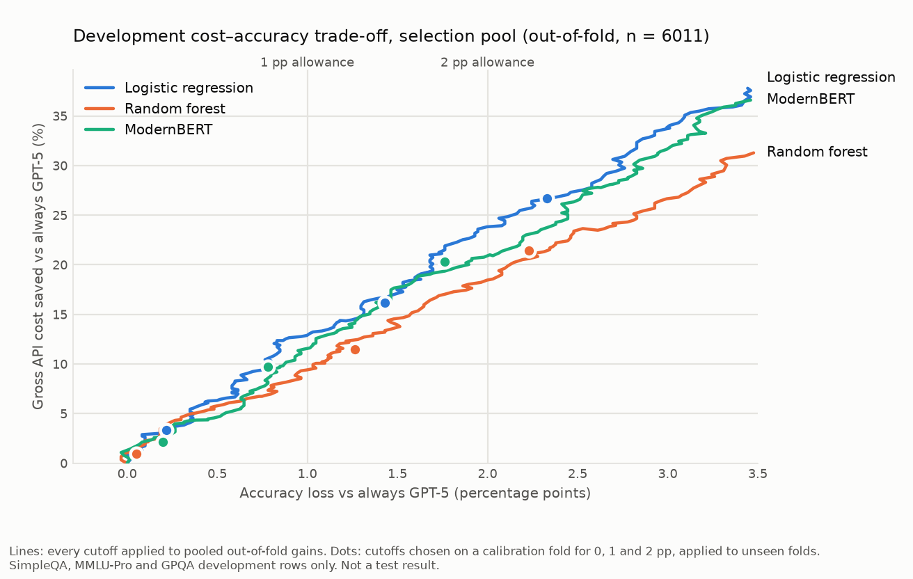

# Development results and algorithm selection (first run, superseded)

> **Superseded.** This is the first selection run of 2026-11-15, on a pool that still
> contained MMLU-Pro math and computer-science questions. On 2026-11-16 the team decided
> to remove those questions and rerun the selection. The current results are in
> `docs/DEV_RESULTS.md`. This file is kept as a record; its result files are in
> `results/dev_selection_v1_unfiltered/`.

Date: 2026-11-15, with the team's decisions of 2026-11-16 added at the end. Everything here uses only the train+validation rows of SimpleQA,
MMLU-Pro and GPQA (6,011 questions). The locked test split, the HLE / code / math
holdouts, ARC-AGI and SWE-bench have not been read by any model. These are development
estimates, not final results.

Source files: `results/dev_selection_v1_unfiltered/selection.json`, per-candidate
`oof_predictions.csv` and `summary.json`, `matched_loss_diagnostic.json`,
`dev_tradeoff.png`. Procedure: `docs/PROTOCOL.md` section 6.

## Outcome

**Selected algorithm: regularized multinomial logistic regression** (C = 0.3, TF-IDF plus
the ten simple prompt statistics). The strict "highest savings at 1 pp" rule and the
parsimony guard pick the same router, so the guard did not change the outcome. Logistic
regression is both the simplest of the three and the one with the highest savings.

## Baselines on the same questions

| Policy | Accuracy | Recorded cost | Savings vs GPT-5 | Accuracy loss |
|---|---:|---:|---:|---:|
| Always GPT-5 | 64.37% | $81.56 | 0% | 0 pp |
| Always Flash | 51.02% | $11.74 | 85.6% | 13.34 pp |

## Candidate comparison (out-of-fold, cutoff chosen on a separate fold)

| Candidate | Allowance | Gross savings (95% CI) | Actual loss, pp (95% CI) | Sent to Flash |
|---|---|---:|---:|---:|
| Logistic regression | 0 pp | 3.4% (2.7 to 4.2) | 0.22 (0.02 to 0.43) | 5.6% |
| | **1 pp** | **16.2% (14.6 to 17.8)** | **1.43 (0.98 to 1.87)** | 26.8% |
| | 2 pp | 26.7% (24.9 to 28.6) | 2.33 (1.77 to 2.92) | 39.4% |
| Random forest | 0 pp | 1.0% (0.5 to 1.5) | 0.05 (−0.08 to 0.20) | 2.4% |
| | **1 pp** | **11.5% (10.2 to 12.9)** | **1.26 (0.86 to 1.67)** | 20.7% |
| | 2 pp | 21.4% (19.8 to 23.1) | 2.23 (1.70 to 2.78) | 34.7% |
| ModernBERT | 0 pp | 2.2% (1.6 to 2.8) | 0.20 (0.03 to 0.37) | 3.6% |
| | **1 pp** | **9.7% (8.4 to 11.1)** | **0.78 (0.43 to 1.13)** | 14.8% |
| | 2 pp | 20.3% (18.5 to 22.0) | 1.76 (1.26 to 2.26) | 30.5% |

Intervals are paired bootstraps over questions with decisions fixed. They do not include
variability from refitting or from choosing cutoffs.

Selection rule at 1 pp: all three qualify (loss ≤ 1.5 pp). Logistic regression has the
highest savings. Paired-bootstrap 90% intervals for the savings difference:
forest − logistic −6.0 to −3.3; ModernBERT − logistic −7.8 to −5.1.

## How to read the comparison

1. **The gap between logistic regression and ModernBERT is mostly a cutoff effect.**
   At the nominal 1 pp allowance they landed at different actual losses (1.43 vs 0.78 pp).
   Comparing at the same actual loss on the pooled out-of-fold gains, the candidates are
   much closer:

   | Actual loss | Logistic | ModernBERT | Forest |
   |---|---:|---:|---:|
   | 0.5 pp | 6.4% | 4.8% | 5.9% |
   | 1.0 pp | 13.0% | 11.6% | 9.4% |
   | 1.5 pp | 17.5% | 17.7% | 14.6% |
   | 2.0 pp | 23.9% | 20.9% | 18.5% |

   This table is a diagnostic computed after the fact (cutoffs chosen on the same pooled
   data), so it is optimistic for all three alike. The supportable statement is that
   ModernBERT was not better than logistic regression here, not that it was much worse.

2. **The allowance is not held out of sample.** Logistic regression and the forest both
   exceed the 1 pp allowance on unseen folds, and all three exceed 0 pp. A cutoff tuned
   on about 1,200 questions to sit exactly at the constraint is optimistic. Per-fold
   results at 1 pp range from 11% to 21% savings and 0.9 to 2.2 pp loss for logistic
   regression. Expect the same behaviour on the locked test, where the cutoff comes from
   2,091 validation questions.

3. **Savings come mainly from one benchmark.** At 1 pp:

   | Candidate | MMLU-Pro (savings / loss / to Flash) | SimpleQA | GPQA |
   |---|---|---|---|
   | Logistic | 35.0% / 3.01 pp / 61% | 5.4% / 0.35 pp / 4% | 8.3% / 1.27 pp / 6% |
   | Forest | 23.1% / 2.30 pp / 45% | 5.8% / 0.61 pp / 5% | 0.0% / 0.00 pp / 0% |
   | ModernBERT | 20.6% / 1.80 pp / 33% | 3.3% / 0.03 pp / 2% | 6.8% / 1.90 pp / 7% |

   The pooled 1 pp budget is spent almost entirely on MMLU-Pro, where the two models are
   closest in accuracy (87.4% vs 81.1%). A pooled allowance does not protect any single
   benchmark: MMLU-Pro alone loses 3 points under the selected candidate. The
   equal-benchmark averages (16.2% savings, 1.54 pp loss for logistic) are similar to the
   pooled ones here.

4. **The question-level signal is weak.** Predicted gain correlates 0.13–0.15 with Y and
   explains 1–2% of its variance for every candidate. A router that knew Y would save
   70% with a 5.5-point accuracy gain on these questions (a ceiling for context, not a
   planned baseline). The candidates capture a small part of that, mostly by recognising
   which kind of question is in front of them.

5. **These savings are not comparable with the pilot's.** The pilot reported about 4.7%
   at 1 pp on all seven benchmarks. The selection pool excludes HLE and LiveCodeBench,
   which are expensive and where GPT-5 is much stronger. Expect lower pooled savings in
   the main study than the 16% seen here.

## Search and compute record

| Candidate | Chosen configuration | Fits | Total fit time | Prediction time | Device |
|---|---|---:|---:|---:|---|
| Logistic | C = 0.3, with statistics | 50 | 59 s | 0.09 ms/question | CPU (M2 Pro) |
| Forest | 300 trees, leaf 20, max_features 0.1, with statistics | 25 | 78 s | 0.13 ms/question | CPU, 8 threads |
| ModernBERT | lr 2e-5, best epoch 1 in four of five fits | 6 | 49 min | 13.9 ms/question | Apple MPS |

- Logistic and forest configurations varied across rotations (C from 0.1 to 1.0); the
  frozen configuration is the one with the lowest mean calibration error.
- ModernBERT ran with prompts truncated to 512 tokens (1.4–1.8% of training prompts
  truncated), at most 8 prompts and 1,536 padded tokens per batch, fp32. Its learning
  rate was chosen in rotation 0 only. Validation error rose after the first epoch in
  most fits. One batch was split after an out-of-memory error in rotation 3.
- ModernBERT had a much smaller search (two learning rates, one seed, 512 tokens) than
  it would get on a real GPU. A larger search might change its standing; this result
  says it did not beat logistic regression under the declared local budget.

## Gross versus net savings

All savings above are gross: recorded API cost only.

Router compute, with stated assumptions (batch serving at full utilisation):

| Candidate | Time per question | Assumed machine price | Router cost per question | As a share of the average GPT-5 call ($0.0136) |
|---|---:|---:|---:|---:|
| Logistic | 0.09 ms CPU | $0.10 per CPU-hour | $0.0000000025 | 0.00002% |
| ModernBERT | 13.9 ms on MPS | $1.00 per GPU-hour | $0.0000039 | 0.03% |

Under these assumptions the router's compute is negligible next to the 16% gross saving,
so net and gross savings agree to two decimal places. This does not cover what a real
deployment would add: an always-on server, idle capacity, added latency per request, and
engineering time. Those were not measured.

## Protocol deviation

One, logged in `docs/PROTOCOL.md`: ModernBERT's batch limit was lowered after the first
attempt ran out of memory. Logistic and forest results carry the protocol hash from
before that log entry; ModernBERT carries the hash after it.

## Added on 2026-11-16 after the team's decisions

- **Parsimony guard.** Kept, and now also requires a more complex router to save at
  least 1.0 percentage point more than the simpler one. The minimum was written down
  after the comparison. It cannot have mattered: the forest saved 4.65 points less than
  logistic regression and ModernBERT 6.42 points less. `selection.json` was regenerated
  with the reworded rule; every candidate metric is identical to the original run, which
  is kept as `selection_2026-11-15_original.json`.
- **MMLU-Pro math and computer-science rows.** The team decided these are excluded from
  the transfer instances. The selection above had already been run with 370 such
  development rows in the pool. Restricting the same out-of-fold decisions to the other
  5,641 rows keeps the order: logistic 14.4% savings (1.40 pp loss), forest 10.1%
  (1.24 pp), ModernBERT 9.1% (0.76 pp). This is an evaluation-only restriction; the
  models were still trained with those rows.

## Not done

- No model has been evaluated on the locked test split, the holdout benchmarks,
  ARC-AGI or SWE-bench. `scripts/07_final_eval.py --unlock-final` runs that once; it was rehearsed
  with `--dry-run` on development rows only.
- No GPU run. ModernBERT was trained on this Mac's MPS backend only.
